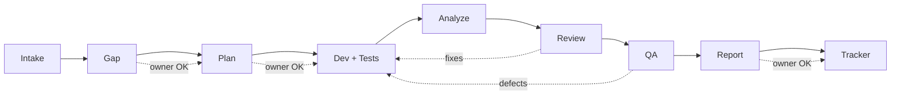

<h1 align="center">Flutter Bot Team Kit</h1>

<p align="center">
  <em>A gated AI bot team for Flutter apps. From requirements to QA report, with you approving every step.</em><br>
  <sub>For Flutter teams that use Cursor or Claude Code and want AI agents that follow their architecture, write tests and never touch git.</sub>
</p>

<p align="center">
  
  
  
  
  
  <br>
  <a href="https://github.com/FaizanUllahDev/flutter-bot-team-kit/stargazers"></a>
  <a href="https://github.com/FaizanUllahDev/flutter-bot-team-kit/commits/main"></a>
  <a href="https://github.com/FaizanUllahDev/flutter-bot-team-kit/releases"></a>
</p>

<p align="center">

<!-- AUTO:VERSION:START -->
Latest version: **1.0.0** (2026-10-20). See [CHANGELOG.md](CHANGELOG.md).
<!-- AUTO:VERSION:END -->

</p>

## Live preview

| Page | Live | Source |
|---|---|---|
| Landing page | [open](https://faizanullahdev.github.io/flutter-bot-team-kit/) | [index.html](index.html) |
| Simple explainer | [open](https://faizanullahdev.github.io/flutter-bot-team-kit/examples/bots_working_simple.html) | [examples/bots_working_simple.html](examples/bots_working_simple.html) |
| Detailed explainer | [open](https://faizanullahdev.github.io/flutter-bot-team-kit/examples/bots_working.html) | [examples/bots_working.html](examples/bots_working.html) |
| QA report template | [open](https://faizanullahdev.github.io/flutter-bot-team-kit/templates/qa-report-template.html) | [templates/qa-report-template.html](templates/qa-report-template.html) |
| Repo structure | [open](https://faizanullahdev.github.io/flutter-bot-team-kit/examples/structure.html) | [examples/structure.html](examples/structure.html) |

<p align="center">
  <a href="examples/bots_working_simple.html"></a>
</p>

<p align="center">
  <!-- AUTO:STATS:START --><strong>9 stages &middot; 15 core bots + 7 optional &middot; 1 summary file per stage</strong><br><!-- AUTO:STATS:END -->
  <sub>By default bots never commit, push or post. You stay in charge of git and your tracker.</sub>
</p>

---

AI agents write Flutter code fast. They also re-read the same docs, skip tests, drift from your architecture and sometimes touch files they should not. This kit gives them a team structure: each bot has one job, writes one short file, and stops for your OK.

> [!NOTE]
> Everything here is generic. Replace `<AI-ROOT>`, `<App-Name>`, `<REPO>` and `<JIRA-KEY>` with your own values, or let the installer do it.

## Contents

- [Live preview](#live-preview)
- [Why](#why)
- [Features](#features)
- [How it works](#how-it-works)
- [What a run looks like](#what-a-run-looks-like)
- [Preview gallery](#preview-gallery)
- [Bots](#bots)
- [Skills](#skills)
- [Repo structure](#repo-structure)
- [Compatibility](#compatibility)
- [Quick start](#quick-start)
- [Configuration](#configuration)
- [Safety](#safety)
- [FAQ](#faq)
- [Roadmap](#roadmap)
- [Contributing](#contributing)
- [License](#license)
- [Acknowledgements](#acknowledgements)

## Why

| Without a team structure | With this kit |
|---|---|
| Every agent re-reads the BRS, ticket and design | Intake bots read once; the rest read a summary |
| Tests added at the end, if at all | Light TDD, 80%+ diff coverage gate |
| New patterns invented per task | Code Analyst caches your architecture first |
| Long reports full of PASS lines | Failures only, plus one "All other PASS" line |
| Risky git or tracker actions | Owner approval gate after every stage |

## Features

- **Gated pipeline:** one approval per stage, answer-only mode when you ask a question.
- **Pick your bots:** <!-- AUTO:CORE_COUNT:START -->15<!-- AUTO:CORE_COUNT:END --> core bots, <!-- AUTO:OPTIONAL_COUNT:START -->7<!-- AUTO:OPTIONAL_COUNT:END --> optional ones you can turn on or off at install.
- **Token saving:** summary-file handoff, signature reads, surgical diffs.
- **Local quality rules:** Codacy-style complexity, size, duplication and coverage checks. No CLI, no network.
- **Domain packs:** generic fintech and telecom best practices, plus a template.
- **Contracts:** fixed output format per stage, so bots loop less.
- **QA report template:** HTML report with an executive scorecard (app, UI, API, functionality scores with A-F grades), UI performance by screen, per-device quality scores, pixel check, translations, error flows and PDF export.
- **Project-first:** your repo's own agents, skills and rules win (safety rules always win).

## How it works



1. **Intake** reads the requirements, ticket, design and code once, and writes `brief.md`.
2. **Gap** compares them and lists conflicts for you to decide.
3. **Plan** turns approved gaps into small tasks with test points.
4. **Dev + Tests** implements with surgical diffs and scenario tests.
5. **Analyze** runs the analyzer and local Codacy-style rules.
6. **Review** checks quality, security, rebuilds and caching.
7. **QA** runs devices, pixel, translation and error-flow checks.
8. **Report** fills the HTML QA report.
9. **Tracker** posts one batch update, only after your OK.

## What a run looks like

Each stage writes one short file to `<AI-ROOT>/<App-Name>/tasks/<JIRA-KEY>/` and stops for your OK.

| Stage | File | What you review |
|---|---|---|
| Intake | `brief.md` | Rules, ticket details, design sizes and code signature in one place |
| Gap | `gap.md` | Conflicts between requirements, design and code, with options |
| Plan | `plan.md` | Small tasks with test points |
| Dev + Tests | diff + tests | Surgical code changes and scenario tests |
| Analyze | `codacy.md` | Local quality grade A-F |
| Review | `review.md` | Quality, security and performance findings |
| QA | `qa.md` | Device, pixel, translation and error-flow results |
| Report | `qa-report.html` | Scored HTML QA report |
| Tracker | `approvals.md` | One batch update, posted only after your OK |

## Preview gallery

### How the bots work (simple)

<table>
  <tr>
    <td align="center" width="50%"><a href="examples/bots_working_simple.html"></a><br><sub>Handoff chain</sub></td>
    <td align="center" width="50%"><a href="examples/bots_working_simple.html"></a><br><sub>Key rules</sub></td>
  </tr>
  <tr>
    <td align="center" width="50%"><a href="examples/bots_working_simple.html"></a><br><sub>Trust and safety</sub></td>
    <td align="center" width="50%"><a href="examples/bots_working_simple.html"></a><br><sub>FAQ</sub></td>
  </tr>
</table>

<details>
<summary><b>Detailed explainer</b></summary>

### How the bots work (detailed)

<table>
  <tr>
    <td align="center" width="50%"><a href="examples/bots_working.html"></a><br><sub>Pipeline map</sub></td>
    <td align="center" width="50%"><a href="examples/bots_working.html"></a><br><sub>Handoff chain</sub></td>
  </tr>
  <tr>
    <td align="center" width="50%"><a href="examples/bots_working.html"></a><br><sub>Grok bots vs Cursor sub-agents</sub></td>
    <td align="center" width="50%"><a href="examples/bots_working.html"></a><br><sub>Fintech vs telecom</sub></td>
  </tr>
  <tr>
    <td align="center" width="50%"><a href="examples/bots_working.html"></a><br><sub>Save paths</sub></td>
  </tr>
</table>

</details>

## Bots

<details open>
<summary><b>Bot table (role, stage, type, output)</b></summary>

<!-- AUTO:BOTS:START -->
| Bot | Stage | Type | Output | Role |
|---|---|---|---|---|
| captain | All | Required | `approvals.md` | Orchestrates the pipeline, routes work, stops at every approval gate |
| brs-analyst | Intake | Required | `brief.md` | Reads the full BRS/requirements doc and distills rules into Where/Given/When/Then |
| code-analyst | Intake | Required | `brief.md` | Scans the target folder once and caches an architecture signature |
| design-analyst | Intake | Required | `brief.md` | Reads the design file once and caches sizes, styles and states |
| tracker-analyst | Intake | Required | `brief.md` | Reads the ticket, comments, attachments and links |
| gap-finder | Gap | Required | `gap.md` | Compares requirements, design and code; lists gaps and conflicts |
| dev-planner | Plan | Required | `plan.md` | Turns approved gaps into a small task plan with test points |
| flutter-dev | Dev+Tests | Required | `diff summary in plan.md` | Implements the plan with surgical diffs and light TDD |
| qa-test-writer | Dev+Tests | Required | `tests + plan.md` | Writes unit/widget tests for each scenario; aims for 80%+ diff coverage |
| codacy-checker | Analyze | Required | `codacy.md` | Applies local Codacy-style rules (complexity, size, duplication, coverage) and grades A-F |
| pr-reviewer | Review | Required | `review.md` | Reviews the diff for quality, security, rebuilds, caching |
| qa-lead | QA | Required | `qa.md` | Defines QA scope, devices and error flows |
| qa-reporter | Report | Required | `qa-report.html` | Fills the QA HTML report from qa.md |
| tracker-updater | Tracker | Required | `approvals.md` | Posts approved updates to the tracker in one batch, only after owner OK |
| cache-keeper | Support | Required | `rules + MEMORY.md` | Owns rules and cache files; syncs every rule change to all rule files |
| captain-b | All | Optional | `approvals.md` | Second captain for parallel tasks |
| tracker-drafter | Plan | Optional | `plan.md` | Drafts subtasks and comments for owner approval |
| localization-checker | Review | Optional | `qa.md` | Checks keys, missing translations, truncation and overflow |
| security-checker | Review | Optional | `review.md` | Checks secrets, storage, logging and network safety |
| crash-analyst | Support | Optional | `crash.md` | Reads crash reports when the owner asks; idle by default |
| firebase-analyst | Support | Optional | `firebase.md` | Reads analytics/config when the owner asks; idle by default |
| git-advisor | Support | Optional | `chat only` | Suggests branch names and commit messages; never runs git |
<!-- AUTO:BOTS:END -->

> [!NOTE]
> Agent files are tool-neutral (`tier: default` or `tier: strong`). Adapters map tiers to models: Claude Code `inherit` / `opus`, Cursor `auto` / your chosen model.
</details>

## Skills

<!-- AUTO:SKILLS:START -->
| Group | Skill | Use |
|---|---|---|
| architecture | feature-module-standard | Single-nest feature layout |
| architecture | flutter-clean-feature | New Clean features (data/domain/presentation) |
| architecture | flutter-legacy-edit | Safe edits in legacy code |
| dev | flutter-responsive-ui | Scaled, overflow-safe UI |
| dev | flutter-reusable-widget | Flow-agnostic shared widgets |
| review | flutter-feature-review | Review checklist |
| qa | qa-report | Fill the QA HTML report template |
| team | coworker-engineer | Co-worker habits and memory |
| team | flutter-captain | Orchestration protocol + safety rules |
| team | getting-started | First-run setup for Grok Bot teams |
| team | team-builder | Creates the bot team |
<!-- AUTO:SKILLS:END -->

## Repo structure

<details>
<summary><b>Folder tree</b></summary>

```
flutter-bot-team-kit/
  README.md  AGENTS.md  CLAUDE.md  LICENSE  CHANGELOG.md  CONTRIBUTING.md  CODE_OF_CONDUCT.md  SECURITY.md
  .github/        ISSUE_TEMPLATE/  PULL_REQUEST_TEMPLATE.md
  .cursor/        rules/team.mdc  agents/        (generated adapter)
  .claude/        agents/  commands/  settings.example.json  (generated adapter)
  scripts/        update-readme.py   (refreshes README AUTO sections)
  install/        INSTALL.md  setup-questions.md  install.sh  lib.sh  gen-adapters.sh
  agents/         core/*.md  optional/*.md   (tool-neutral source)
  skills/         architecture/  dev/  review/  qa/  team/
  contracts/      brief gap plan review codacy qa
  domains/        fintech/  telecom/  _template/
  templates/      task/*.md  codacy-rules.md  quality-must-haves.md  devices.md  project-context.md  qa-report-template.html
  project-overrides/README.md
  examples/       bots_working.html  bots_working_simple.html  structure.html
  index.html  .nojekyll   (GitHub Pages landing)
  docs/           images/sections/  media/
```
</details>

## Compatibility

One source of truth (`agents/`, `skills/`, `AGENTS.md`), two thin adapters.

| Feature | Cursor | Claude Code |
|---|---|---|
| Team rules | `.cursor/rules/team.mdc` (from AGENTS.md, `alwaysApply`) | `CLAUDE.md` imports `@AGENTS.md` |
| Subagents | `~/.cursor/agents/` or `<REPO>/.cursor/agents/` | `~/.claude/agents/` or `<REPO>/.claude/agents/` |
| Model mapping | default `auto`, strong = your model name | default `inherit`, strong = `opus` |
| Skills | `~/.cursor/skills/<name>/SKILL.md` | `~/.claude/skills/<name>/SKILL.md` |
| Commands | chat: `@captain build-feature <JIRA-KEY>` | `/build-feature`, `/fix-bug`, `/review`, `/qa-report` |
| Safety settings | rules + approval gates | `.claude/settings.json` deny list (secrets, test accounts, git push/commit) |
| Grok Bot teams | `getting-started` + `team-builder` skills | same |

## Quick start

```bash
git clone https://github.com/FaizanUllahDev/flutter-bot-team-kit.git
cd flutter-bot-team-kit
bash install/install.sh --dry-run   # preview, writes nothing
bash install/install.sh             # target: cursor / claude / both, scope: global / project
```

The installer also asks **Who handles git?** (you, the default, or bots after your OK per action). Skip the question with `--git=self` or `--git=bots`.

<details open>
<summary><b>Cursor</b></summary>

1. Run the installer with target `cursor` (or `both`) and scope `project` to also get `.cursor/rules/team.mdc`.
2. Open the repo in Cursor. Chat: `@captain build-feature <JIRA-KEY>` or `@captain fix-issue`.
</details>

<details open>
<summary><b>Claude Code</b></summary>

1. Run the installer with target `claude` (or `both`) and scope `project`.
2. It writes `AGENTS.md`, `CLAUDE.md` (with `@AGENTS.md`), `.claude/agents/`, `.claude/skills/`, `.claude/commands/` and `.claude/settings.json` (from the safe example).
3. Start `claude` in the repo. Run `/build-feature <JIRA-KEY>`, `/fix-bug`, `/review` or `/qa-report <JIRA-KEY>`.
</details>

Manual steps, Grok Bot setup and adapter regeneration: [install/INSTALL.md](install/INSTALL.md).

## Configuration

<details>
<summary><b>What you can change</b></summary>

| What | Where |
|---|---|
| Setup questions | [install/setup-questions.md](install/setup-questions.md) |
| Optional bots | installer toggles, or `agents/optional/` |
| Project rules | `project-overrides/<App-Name>.md` |
| Domain rules | `domains/<domain>/DOMAIN.md` or copy `_template/` |
| Quality thresholds | [templates/codacy-rules.md](templates/codacy-rules.md) |
| Stage output formats | [contracts/](contracts/) |
| Model per bot | `model:` in each agent file |
| fvm on/off | installer question; analyzer gate adapts |
| Tool target | installer: cursor / claude / both |
| Git mode | installer question or `--git=self\|bots` |
| Adapters | edit `agents/` or `AGENTS.md`, then `bash install/gen-adapters.sh` |
</details>

## Safety

> [!IMPORTANT]
> These rules win over every project override.

- Never read or output secrets (.env, key files, keystores, service config, credentials).
- Never edit `android/` or `ios/` without file-specific approval.
- By default bots never commit, push, rebase or tag. You do all git. You can opt in per bot by editing its agent file (see FAQ); repo auth always stays with you.
- No tracker posts or status changes without your approval.
- Test accounts stay in one local file. Never in tracker, cloud, memory or reports. No PIN in screenshots.
- No `print()`. Use the project logger.

## FAQ

<details>
<summary><b>Do the bots touch git?</b></summary>

Not by default. Bots never commit, push, rebase or tag, and you do all git yourself.

- **Opt in at install:** pick "Let bots run git" (or `bash install/install.sh --git=bots`). Only flutter-dev and git-advisor may then run git, after your OK for each action. Force-push, `reset --hard` and rewriting pushed history stay blocked.
- **Opt in by hand:** edit an agent file (for example `agents/core/flutter-dev.md`), allow the git commands you want, then run `bash install/gen-adapters.sh`.
- **Auth stays with you:** SSH keys, tokens and GitHub login are never asked for or stored.
</details>

<details>
<summary><b>Which AI tools does it work with?</b></summary>

Cursor and Claude Code, from one tool-neutral source. Grok Bot teams are supported through the `getting-started` and `team-builder` skills.
</details>

<details>
<summary><b>Do I need Jira?</b></summary>

No. The installer asks for your tracker (Jira, Linear or none) and writes it into the team rules. Tracker bots only post after your OK, so with none you simply skip that stage.
</details>

<details>
<summary><b>Can I preview the install first?</b></summary>

Yes. `bash install/install.sh --dry-run` shows what would be written and writes nothing.
</details>

<details>
<summary><b>Can I turn bots off?</b></summary>

Yes. <!-- AUTO:CORE_COUNT:START -->15<!-- AUTO:CORE_COUNT:END --> core bots are required and <!-- AUTO:OPTIONAL_COUNT:START -->7<!-- AUTO:OPTIONAL_COUNT:END --> are optional. Pick them in the installer or edit `agents/optional/`.
</details>

<details>
<summary><b>Will it follow my project's own rules?</b></summary>

Yes. Your repo's own agents, skills and rules win, and you can add more in `project-overrides/<App-Name>.md`. The [Safety](#safety) rules always win over any override.
</details>

<details>
<summary><b>How do I add a bot or a skill?</b></summary>

Add the agent file (with `stage:` and `output:`) or the `SKILL.md` (with `summary:`). The bot and skill tables, counts and version in this README update automatically on push, or run `python3 scripts/update-readme.py` locally. See [CONTRIBUTING.md](CONTRIBUTING.md).
</details>

<details>
<summary><b>Does it send my code anywhere?</b></summary>

The kit itself adds no network calls. Quality checks run locally with no CLI or upload. Your AI tool's own data policy still applies.
</details>

## Roadmap

- [ ] More domain packs (e-commerce, health)
- [ ] Bloc and Riverpod variants of the architecture skills
- [ ] Sample app showing a full pipeline run
- [ ] Installer support for Windows (PowerShell)
- [ ] Contract validators (lint stage files)

## Contributing

PRs welcome. Read [CONTRIBUTING.md](CONTRIBUTING.md) and the [Code of Conduct](CODE_OF_CONDUCT.md). Want a new bot? Use the **New bot** issue template.

## License

[MIT](LICENSE).

## Acknowledgements

- Created by [Faizan Ullah](https://github.com/FaizanUllahDev)
- [Flutter](https://flutter.dev) and its community
- [Cursor](https://cursor.com) subagents and skills
- [Claude Code](https://code.claude.com/docs) subagents, skills and slash commands
- [Contributor Covenant](https://www.contributor-covenant.org)
- [shields.io](https://shields.io) for badges
