<h1 align="center">Flutter Bot Team Kit</h1>

<p align="center">
  <em>A gated AI bot team for Flutter apps. From requirements to QA report, with you approving every step.</em>
</p>

<p align="center">
  
  
  
  
  
</p>

<h3 align="center">Live preview</h3>

<p align="center">
  <a href="https://faizanullahdev.github.io/flutter-bot-team-kit/"><b>Landing page</b></a> &middot;
  <a href="https://faizanullahdev.github.io/flutter-bot-team-kit/examples/bots_working_simple.html"><b>How the bots work (simple)</b></a> &middot;
  <a href="https://faizanullahdev.github.io/flutter-bot-team-kit/examples/bots_working.html"><b>How the bots work (detailed)</b></a> &middot;
  <a href="https://faizanullahdev.github.io/flutter-bot-team-kit/templates/qa-report-template.html"><b>QA report template</b></a>
</p>

| Page | GitHub Pages (live) | Fallback preview | Source |
|---|---|---|---|
| Simple explainer | [open](https://faizanullahdev.github.io/flutter-bot-team-kit/examples/bots_working_simple.html) | [htmlpreview](https://htmlpreview.github.io/?https://github.com/FaizanUllahDev/flutter-bot-team-kit/blob/main/examples/bots_working_simple.html) | [examples/bots_working_simple.html](examples/bots_working_simple.html) |
| Detailed explainer | [open](https://faizanullahdev.github.io/flutter-bot-team-kit/examples/bots_working.html) | [htmlpreview](https://htmlpreview.github.io/?https://github.com/FaizanUllahDev/flutter-bot-team-kit/blob/main/examples/bots_working.html) | [examples/bots_working.html](examples/bots_working.html) |
| QA report template | [open](https://faizanullahdev.github.io/flutter-bot-team-kit/templates/qa-report-template.html) | [htmlpreview](https://htmlpreview.github.io/?https://github.com/FaizanUllahDev/flutter-bot-team-kit/blob/main/templates/qa-report-template.html) | [templates/qa-report-template.html](templates/qa-report-template.html) |
| Repo structure | [open](https://faizanullahdev.github.io/flutter-bot-team-kit/examples/structure.html) | [htmlpreview](https://htmlpreview.github.io/?https://github.com/FaizanUllahDev/flutter-bot-team-kit/blob/main/examples/structure.html) | [examples/structure.html](examples/structure.html) |

> [!NOTE]
> Live links need GitHub Pages: **Settings > Pages > Deploy from a branch > `main` / `(root)`**. The root `index.html` is the landing page; `docs/index.html` is a mirror.

<p align="center">
  <a href="examples/bots_working_simple.html">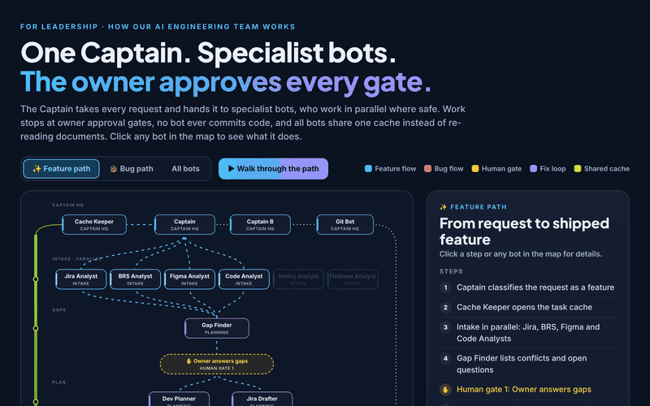</a>
</p>

<p align="center">
  <strong>9 stages &middot; 15 core bots + 7 optional &middot; 1 summary file per stage</strong><br>
  <sub>Bots never commit, push or post. You stay in charge of git and your tracker.</sub>
</p>

---

AI agents write Flutter code fast. They also re-read the same docs, skip tests, drift from your architecture and sometimes touch files they should not. This kit gives them a team structure: each bot has one job, writes one short file, and stops for your OK.

> [!NOTE]
> Everything here is generic. Replace `<AI-ROOT>`, `<App-Name>`, `<REPO>` and `<JIRA-KEY>` with your own values, or let the installer do it.

## Contents

- [Live preview](#live-preview)
- [Why](#why)
- [Features](#features)
- [How it works](#how-it-works)
- [Preview gallery](#preview-gallery)
- [Bots](#bots)
- [Skills](#skills)
- [Repo structure](#repo-structure)
- [Compatibility](#compatibility)
- [Quick start](#quick-start)
- [Configuration](#configuration)
- [Safety](#safety)
- [Roadmap](#roadmap)
- [Contributing](#contributing)
- [License](#license)
- [Acknowledgements](#acknowledgements)

## Why

| Without a team structure | With this kit |
|---|---|
| Every agent re-reads the BRS, ticket and design | Intake bots read once; the rest read a summary |
| Tests added at the end, if at all | Light TDD, 80%+ diff coverage gate |
| New patterns invented per task | Code Analyst caches your architecture first |
| Long reports full of PASS lines | Failures only, plus one "All other PASS" line |
| Risky git or tracker actions | Owner approval gate after every stage |

## Features

- **Gated pipeline:** one approval per stage, answer-only mode when you ask a question.
- **Pick your bots:** 15 core bots, 7 optional ones you can turn on or off at install.
- **Token saving:** summary-file handoff, signature reads, surgical diffs.
- **Local quality rules:** Codacy-style complexity, size, duplication and coverage checks. No CLI, no network.
- **Domain packs:** generic fintech and telecom best practices, plus a template.
- **Contracts:** fixed output format per stage, so bots loop less.
- **QA report template:** HTML report with an executive scorecard (app, UI, API, functionality scores with A-F grades), UI performance by screen, per-device quality scores, pixel check, translations, error flows and PDF export.
- **Project-first:** your repo's own agents, skills and rules win (safety rules always win).

## How it works

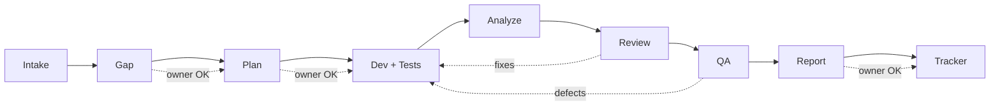

1. **Intake** reads the requirements, ticket, design and code once, and writes `brief.md`.
2. **Gap** compares them and lists conflicts for you to decide.
3. **Plan** turns approved gaps into small tasks with test points.
4. **Dev + Tests** implements with surgical diffs and scenario tests.
5. **Analyze** runs the analyzer and local Codacy-style rules.
6. **Review** checks quality, security, rebuilds and caching.
7. **QA** runs devices, pixel, translation and error-flow checks.
8. **Report** fills the HTML QA report.
9. **Tracker** posts one batch update, only after your OK.

## Preview gallery

> [!TIP]
> GitHub cannot render these pages inline. Click any image for the HTML source, then open it locally in a browser or use the [Live preview](#live-preview) links.

### How the bots work (simple)

<p align="center"><a href="examples/bots_working_simple.html"></a><br><sub><a href="docs/media/bots-working-simple.mp4">MP4 version</a></sub></p>

<table>
  <tr>
    <td align="center" width="50%"><a href="examples/bots_working_simple.html">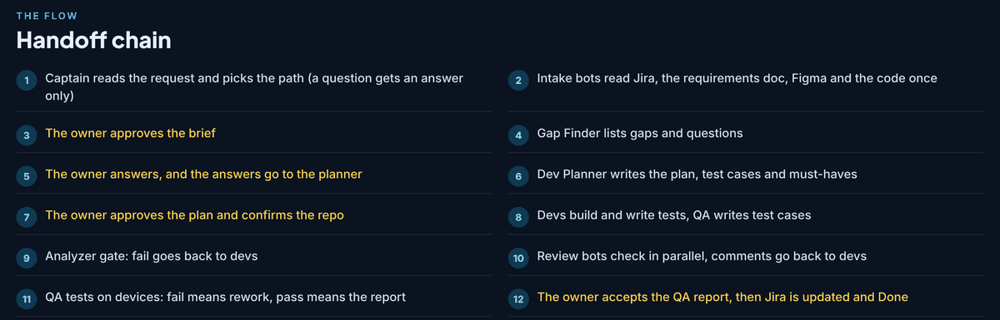</a><br><sub>Handoff chain</sub></td>
    <td align="center" width="50%"><a href="examples/bots_working_simple.html">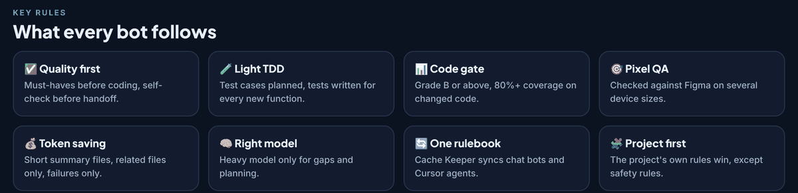</a><br><sub>Key rules</sub></td>
  </tr>
  <tr>
    <td align="center" width="50%"><a href="examples/bots_working_simple.html">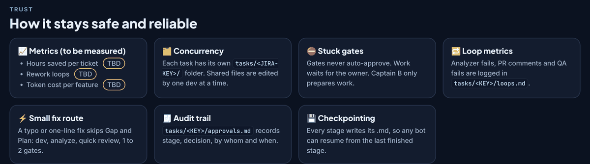</a><br><sub>Trust and safety</sub></td>
    <td align="center" width="50%"><a href="examples/bots_working_simple.html">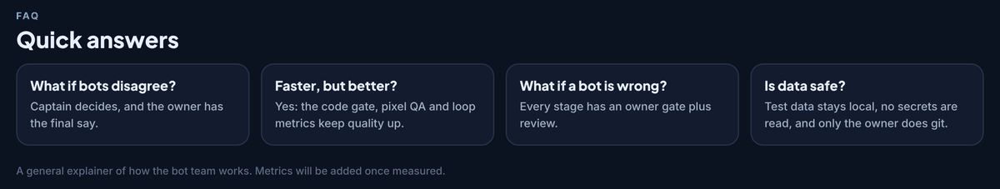</a><br><sub>FAQ</sub></td>
  </tr>
</table>

<details>
<summary><b>Detailed explainer</b></summary>

### How the bots work (detailed)

<p align="center"><a href="examples/bots_working.html">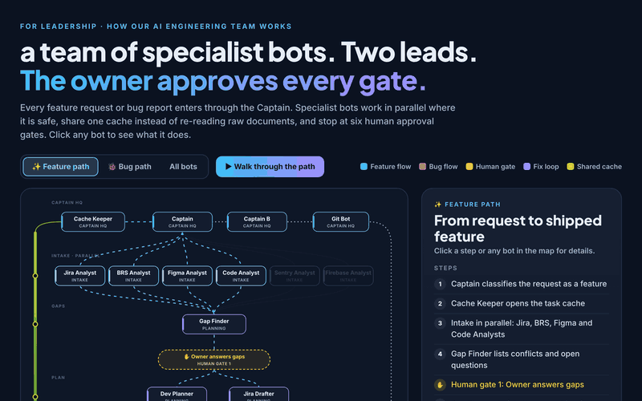</a><br><sub><a href="docs/media/bots-working.mp4">MP4 version</a></sub></p>

<table>
  <tr>
    <td align="center" width="50%"><a href="examples/bots_working.html">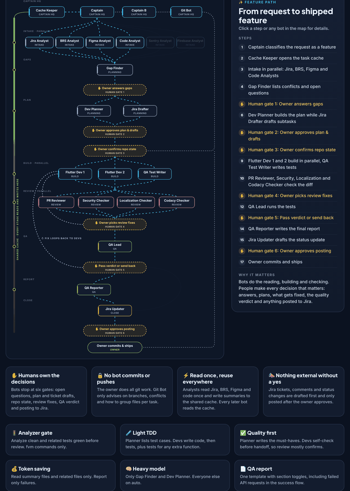</a><br><sub>Pipeline map</sub></td>
    <td align="center" width="50%"><a href="examples/bots_working.html">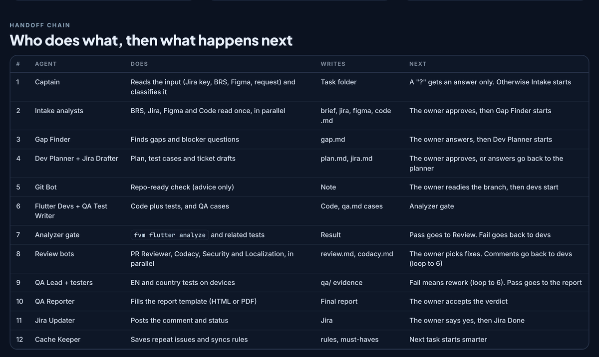</a><br><sub>Handoff chain</sub></td>
  </tr>
  <tr>
    <td align="center" width="50%"><a href="examples/bots_working.html">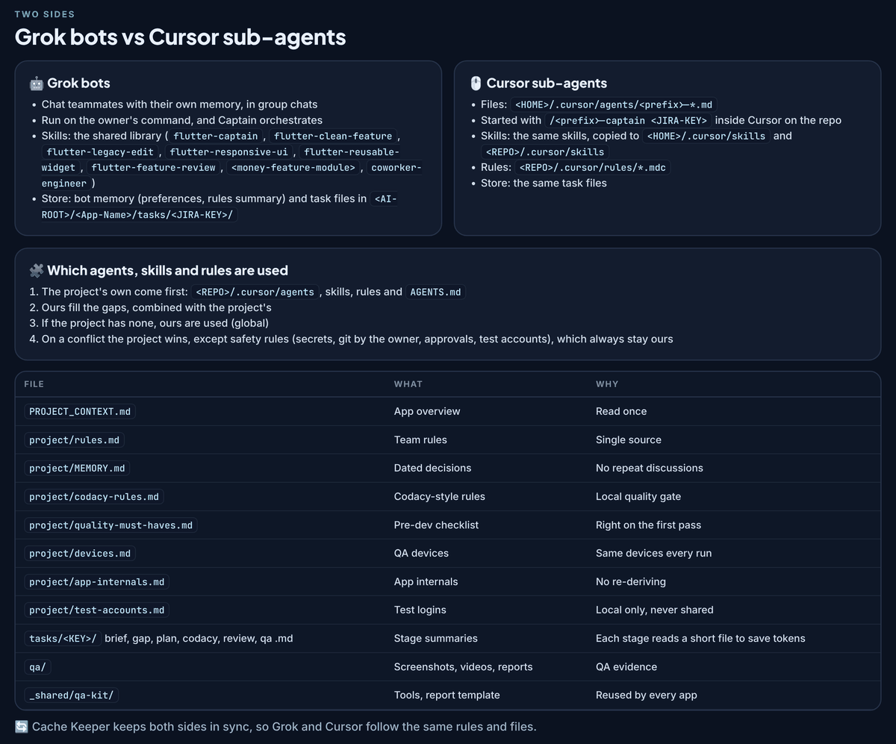</a><br><sub>Grok bots vs Cursor sub-agents</sub></td>
    <td align="center" width="50%"><a href="examples/bots_working.html">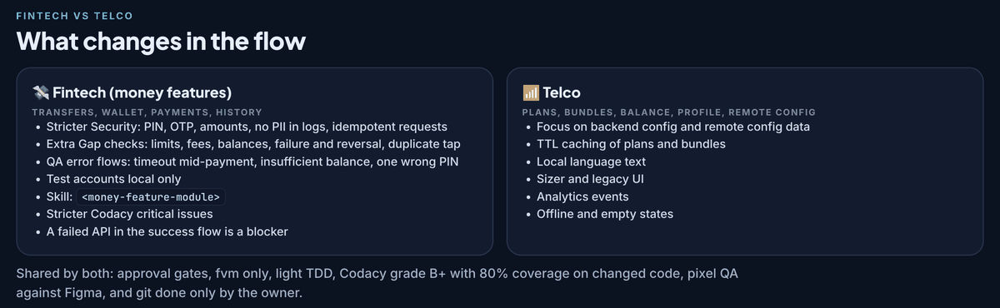</a><br><sub>Fintech vs telecom</sub></td>
  </tr>
  <tr>
    <td align="center" width="50%"><a href="examples/bots_working.html">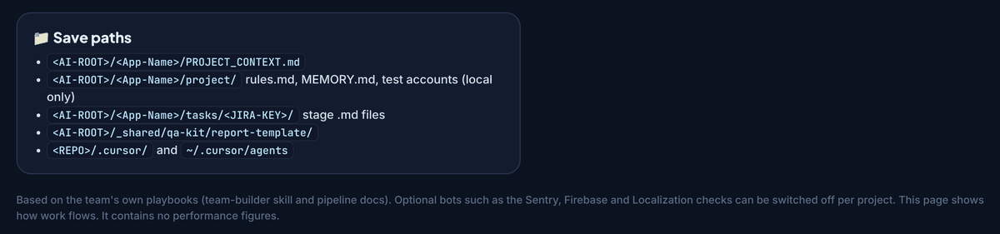</a><br><sub>Save paths</sub></td>
  </tr>
</table>

</details>

### QA report template

<p align="center"><a href="templates/qa-report-template.html">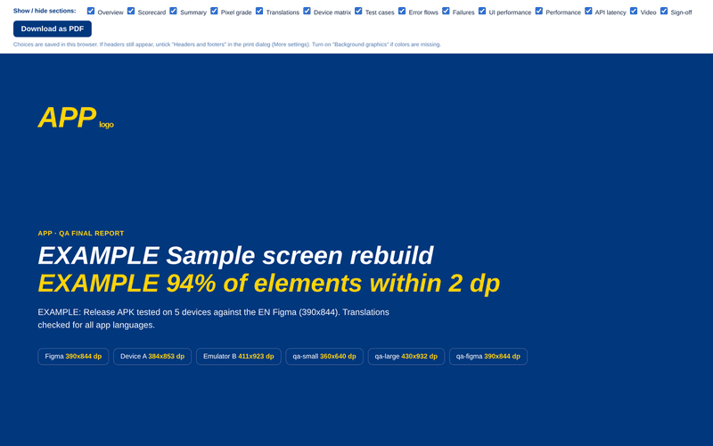</a><br><sub><a href="docs/media/qa-report-template.mp4">MP4 version</a></sub></p>

<table>
  <tr>
    <td align="center" width="50%"><a href="templates/qa-report-template.html">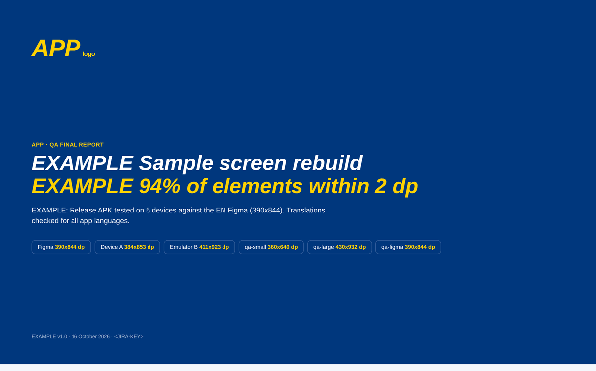</a><br><sub>Cover</sub></td>
    <td align="center" width="50%"><a href="templates/qa-report-template.html">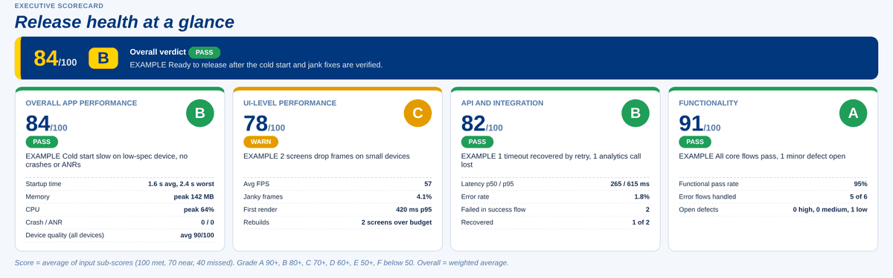</a><br><sub>Executive scorecard (A-F grades)</sub></td>
  </tr>
  <tr>
    <td align="center" width="50%"><a href="templates/qa-report-template.html">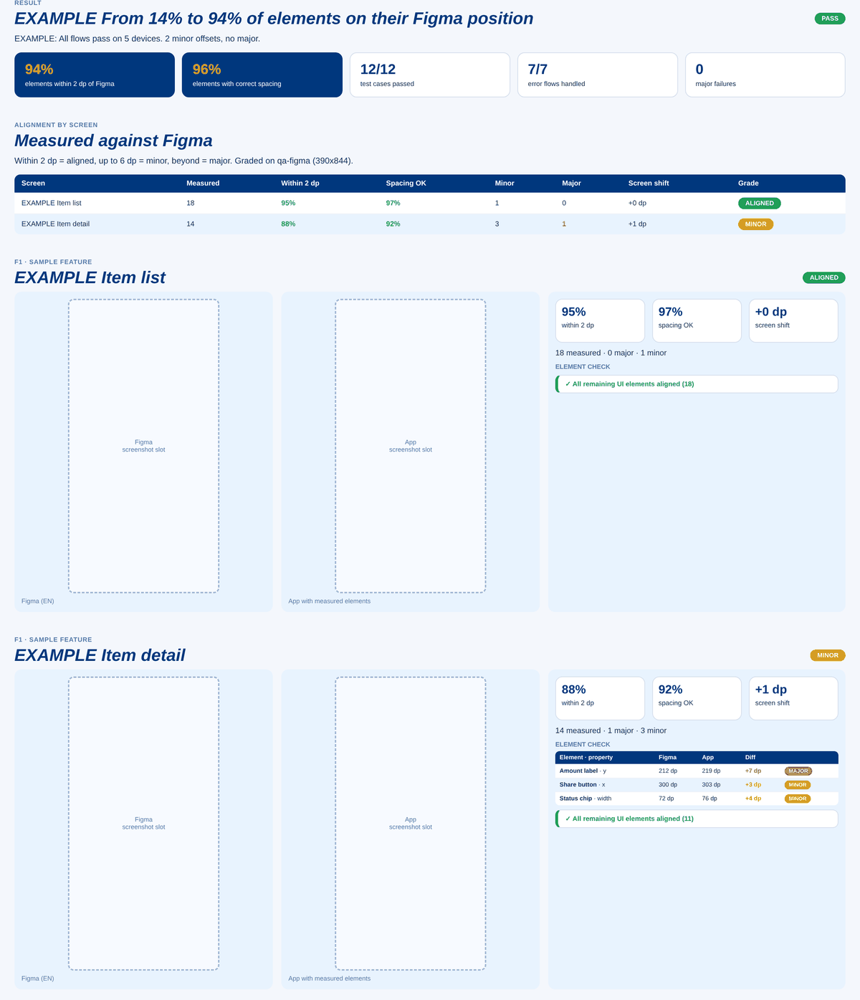</a><br><sub>Pixel test vs design</sub></td>
    <td align="center" width="50%"><a href="templates/qa-report-template.html">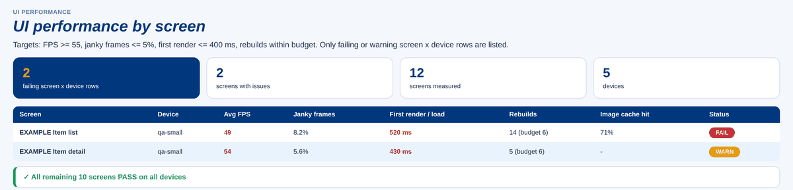</a><br><sub>UI performance by screen</sub></td>
  </tr>
  <tr>
    <td align="center" width="50%"><a href="templates/qa-report-template.html">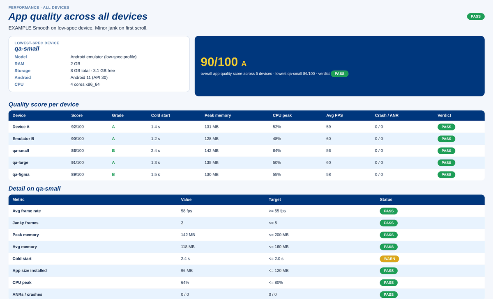</a><br><sub>Quality score per device</sub></td>
    <td align="center" width="50%"><a href="templates/qa-report-template.html">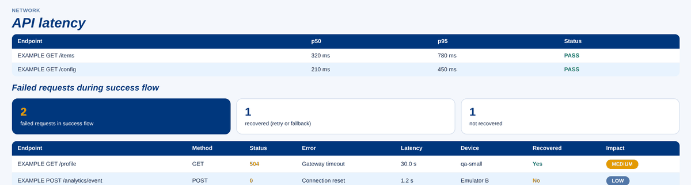</a><br><sub>API latency and failed requests</sub></td>
  </tr>
  <tr>
    <td align="center" width="50%"><a href="templates/qa-report-template.html">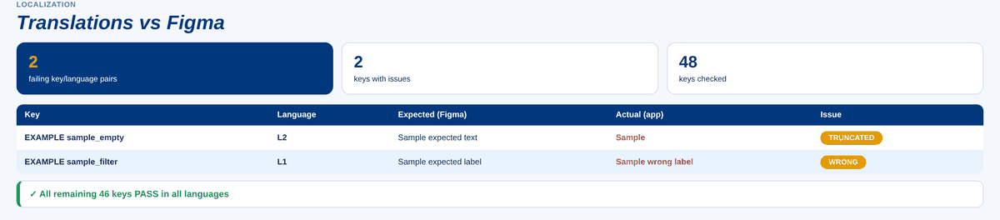</a><br><sub>Translations (failures only)</sub></td>
    <td align="center" width="50%"><a href="templates/qa-report-template.html">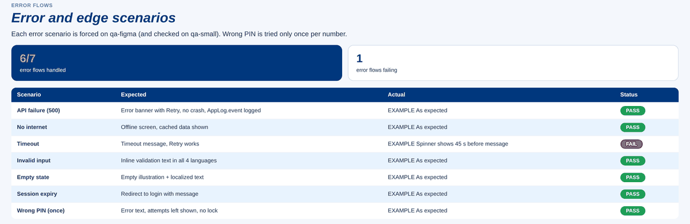</a><br><sub>Error flows</sub></td>
  </tr>
</table>

### Repository structure

<p align="center"><a href="examples/structure.html">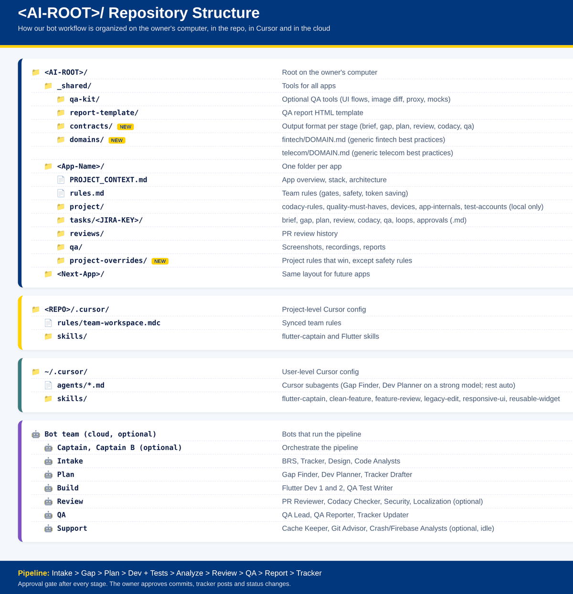</a></p>

## Bots

<details open>
<summary><b>Bot table (role, stage, type, output)</b></summary>

| Bot | Stage | Type | Output | Role |
|---|---|---|---|---|
| captain | All | Required | `approvals.md` | Orchestrates the pipeline, routes work, stops at every approval gate |
| brs-analyst | Intake | Required | `brief.md` | Reads the full BRS/requirements doc and distills rules into Where/Given/When/Then |
| tracker-analyst | Intake | Required | `brief.md` | Reads the ticket, comments, attachments and links |
| design-analyst | Intake | Required | `brief.md` | Reads the design file once and caches sizes, styles and states |
| code-analyst | Intake | Required | `brief.md` | Scans the target folder once and caches an architecture signature |
| gap-finder | Gap | Required | `gap.md` | Compares requirements, design and code; lists gaps and conflicts |
| dev-planner | Plan | Required | `plan.md` | Turns approved gaps into a small task plan with test points |
| flutter-dev | Dev+Tests | Required | `diff summary in plan.md` | Implements the plan with surgical diffs and light TDD |
| qa-test-writer | Dev+Tests | Required | `tests + plan.md` | Writes unit/widget tests for each scenario; aims for 80%+ diff coverage |
| pr-reviewer | Review | Required | `review.md` | Reviews the diff for quality, security, rebuilds, caching |
| codacy-checker | Analyze | Required | `codacy.md` | Applies local Codacy-style rules (complexity, size, duplication, coverage) and grades A-F |
| qa-lead | QA | Required | `qa.md` | Defines QA scope, devices and error flows |
| qa-reporter | Report | Required | `qa-report.html` | Fills the QA HTML report from qa.md |
| tracker-updater | Tracker | Required | `approvals.md` | Posts approved updates to the tracker in one batch, only after owner OK |
| cache-keeper | Support | Required | `rules + MEMORY.md` | Owns rules and cache files; syncs every rule change to all rule files |
| security-checker | Review | Optional | `review.md` | Checks secrets, storage, logging and network safety |
| localization-checker | Review | Optional | `qa.md` | Checks keys, missing translations, truncation and overflow |
| git-advisor | Support | Optional | `chat only` | Suggests branch names and commit messages; never runs git |
| crash-analyst | Support | Optional | `crash.md` | Reads crash reports when the owner asks; idle by default |
| firebase-analyst | Support | Optional | `firebase.md` | Reads analytics/config when the owner asks; idle by default |
| captain-b | All | Optional | `approvals.md` | Second captain for parallel tasks |
| tracker-drafter | Plan | Optional | `plan.md` | Drafts subtasks and comments for owner approval |

> [!NOTE]
> Agent files are tool-neutral (`tier: default` or `tier: strong`). Adapters map tiers to models: Claude Code `inherit` / `opus`, Cursor `auto` / your chosen model.
</details>

## Skills

| Group | Skill | Use |
|---|---|---|
| architecture | flutter-clean-feature | New Clean features (data/domain/presentation) |
| architecture | flutter-legacy-edit | Safe edits in legacy code |
| architecture | feature-module-standard | Single-nest feature layout |
| dev | flutter-responsive-ui | Scaled, overflow-safe UI |
| dev | flutter-reusable-widget | Flow-agnostic shared widgets |
| review | flutter-feature-review | Review checklist |
| qa | qa-report | Fill the QA HTML report template |
| team | flutter-captain | Orchestration protocol + safety rules |
| team | coworker-engineer | Co-worker habits and memory |
| team | getting-started | First-run setup for Grok Bot teams |
| team | team-builder | Creates the bot team |

## Repo structure

<details>
<summary><b>Folder tree</b></summary>

```
flutter-bot-team-kit/
  README.md  AGENTS.md  CLAUDE.md  LICENSE  CHANGELOG.md  CONTRIBUTING.md  CODE_OF_CONDUCT.md  SECURITY.md
  .github/        ISSUE_TEMPLATE/  PULL_REQUEST_TEMPLATE.md
  .cursor/        rules/team.mdc  agents/        (generated adapter)
  .claude/        agents/  commands/  settings.example.json  (generated adapter)
  install/        INSTALL.md  setup-questions.md  install.sh  lib.sh  gen-adapters.sh
  agents/         core/*.md  optional/*.md   (tool-neutral source)
  skills/         architecture/  dev/  review/  qa/  team/
  contracts/      brief gap plan review codacy qa
  domains/        fintech/  telecom/  _template/
  templates/      task/*.md  codacy-rules.md  quality-must-haves.md  devices.md  project-context.md  qa-report-template.html
  project-overrides/README.md
  examples/       bots_working.html  bots_working_simple.html  structure.html
  index.html  .nojekyll   (GitHub Pages landing)
  docs/           index.html  images/sections/  media/ (GIF + MP4)
```
</details>

## Compatibility

One source of truth (`agents/`, `skills/`, `AGENTS.md`), two thin adapters.

| Feature | Cursor | Claude Code |
|---|---|---|
| Team rules | `.cursor/rules/team.mdc` (from AGENTS.md, `alwaysApply`) | `CLAUDE.md` imports `@AGENTS.md` |
| Subagents | `~/.cursor/agents/` or `<REPO>/.cursor/agents/` | `~/.claude/agents/` or `<REPO>/.claude/agents/` |
| Model mapping | default `auto`, strong = your model name | default `inherit`, strong = `opus` |
| Skills | `~/.cursor/skills/<name>/SKILL.md` | `~/.claude/skills/<name>/SKILL.md` |
| Commands | chat: `@captain build-feature <JIRA-KEY>` | `/build-feature`, `/fix-bug`, `/review`, `/qa-report` |
| Safety settings | rules + approval gates | `.claude/settings.json` deny list (secrets, test accounts, git push/commit) |
| Grok Bot teams | `getting-started` + `team-builder` skills | same |

## Quick start

```bash
git clone https://github.com/FaizanUllahDev/flutter-bot-team-kit.git
cd flutter-bot-team-kit
bash install/install.sh --dry-run   # preview, writes nothing
bash install/install.sh             # target: cursor / claude / both, scope: global / project
```

<details open>
<summary><b>Cursor</b></summary>

1. Run the installer with target `cursor` (or `both`) and scope `project` to also get `.cursor/rules/team.mdc`.
2. Open the repo in Cursor. Chat: `@captain build-feature <JIRA-KEY>` or `@captain fix-issue`.
</details>

<details open>
<summary><b>Claude Code</b></summary>

1. Run the installer with target `claude` (or `both`) and scope `project`.
2. It writes `AGENTS.md`, `CLAUDE.md` (with `@AGENTS.md`), `.claude/agents/`, `.claude/skills/`, `.claude/commands/` and `.claude/settings.json` (from the safe example).
3. Start `claude` in the repo. Run `/build-feature <JIRA-KEY>`, `/fix-bug`, `/review` or `/qa-report <JIRA-KEY>`.
</details>

Manual steps, Grok Bot setup and adapter regeneration: [install/INSTALL.md](install/INSTALL.md).

## Configuration

<details>
<summary><b>What you can change</b></summary>

| What | Where |
|---|---|
| Setup questions | [install/setup-questions.md](install/setup-questions.md) |
| Optional bots | installer toggles, or `agents/optional/` |
| Project rules | `project-overrides/<App-Name>.md` |
| Domain rules | `domains/<domain>/DOMAIN.md` or copy `_template/` |
| Quality thresholds | [templates/codacy-rules.md](templates/codacy-rules.md) |
| Stage output formats | [contracts/](contracts/) |
| Model per bot | `model:` in each agent file |
| fvm on/off | installer question; analyzer gate adapts |
| Tool target | installer: cursor / claude / both |
| Adapters | edit `agents/` or `AGENTS.md`, then `bash install/gen-adapters.sh` |
</details>

## Safety

> [!IMPORTANT]
> These rules win over every project override.

- Never read or output secrets (.env, key files, keystores, service config, credentials).
- Never edit `android/` or `ios/` without file-specific approval.
- Bots never commit, push, rebase or tag. You do all git.
- No tracker posts or status changes without your approval.
- Test accounts stay in one local file. Never in tracker, cloud, memory or reports. No PIN in screenshots.
- No `print()`. Use the project logger.

## Roadmap

- [ ] More domain packs (e-commerce, health)
- [ ] Bloc and Riverpod variants of the architecture skills
- [ ] Sample app showing a full pipeline run
- [ ] Installer support for Windows (PowerShell)
- [ ] Contract validators (lint stage files)

## Contributing

PRs welcome. Read [CONTRIBUTING.md](CONTRIBUTING.md) and the [Code of Conduct](CODE_OF_CONDUCT.md). Want a new bot? Use the **New bot** issue template.

## License

[MIT](LICENSE).

## Acknowledgements

- Created by [Faizan Ullah](https://github.com/FaizanUllahDev)
- [Claude Code](https://code.claude.com/docs) subagents, skills and slash commands

- [Flutter](https://flutter.dev) and its community
- [Cursor](https://cursor.com) subagents and skills
- [Contributor Covenant](https://www.contributor-covenant.org)
- [shields.io](https://shields.io) for badges
